# Win2Mac Studio

[](https://github.com/cv-superding/win2mac-studio) [](https://github.com/cv-superding/win2mac-studio/actions/workflows/macos-verify.yml)

安装包与 MacCheck 工具见 [GitHub Releases](https://github.com/cv-superding/win2mac-studio/releases)。

把 Windows 10/11 应用打包成可拷到 Mac 的 `.app` —— 在 Windows 上完成扫描、兼容性评估、原样复制、注册表快照、图标转换与 ZIP 生成，不需要 Mac 构建机。

> “无损”在这里指：**原 Windows 文件逐字节保留、SHA-256 可验证、卸载项与常见厂商注册表键、AppData 用户配置、快捷方式参数、工作目录、图标一并打包**。它不指“100% 兼容”或“原生 Mac 移植”；Wine 的内核驱动、反作弊、DRM、USB 直通等边界无法消除。

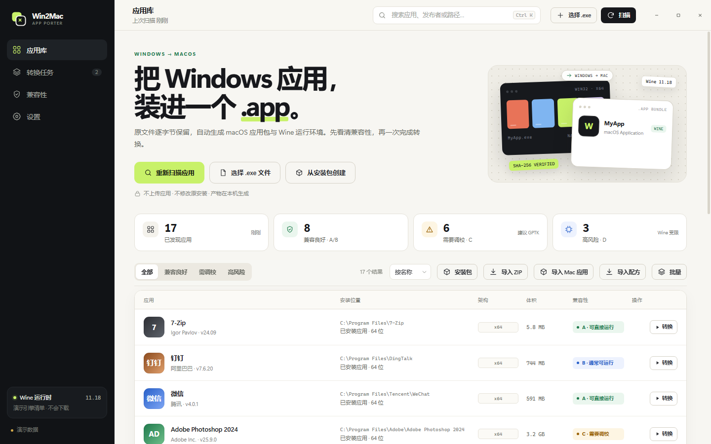

真实 Windows 11 扫描（172 个应用、172 个真实图标，A/B 101、C 55、D 16）：

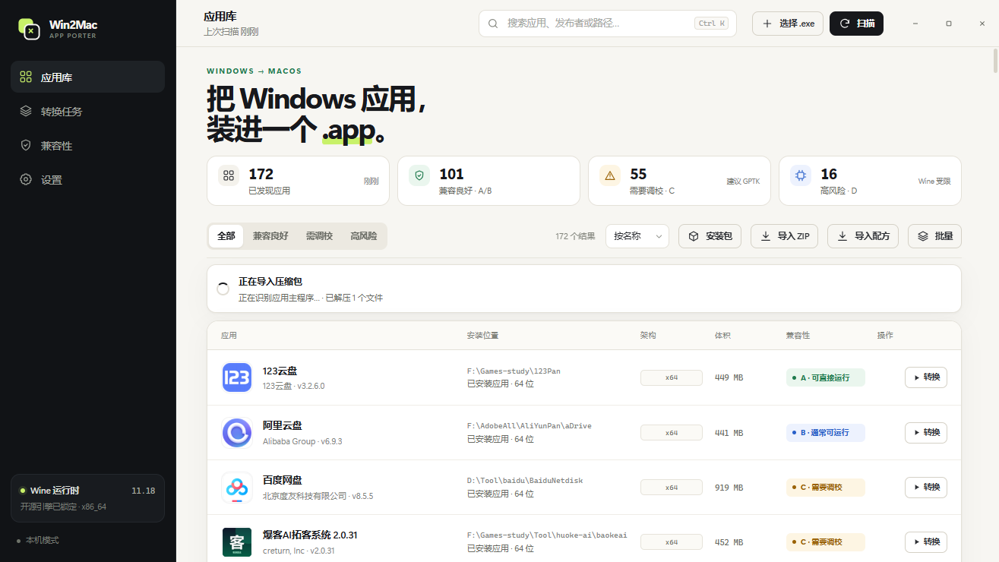

## 为什么做这个

Windows 应用迁移到 Mac，现有工具几乎都在 Mac 端操作（Whisky、Wineskin/Sikarugir、CrossOver），或者需要虚拟机（WinApps/UTM）。Win2Mac 把“发现应用 → 判断兼容性 → 生成标准 .app → 首次运行自动建瓶”放在 Windows 本机完成，目标用户是把旧 Windows 工具带到 Mac 的人。

调研了 Whisky、Wineskin/Sikarugir、Mythic、Bridgeplay、WinApps、Apple GPTK、CrossOver、Gcenx Wine 等 20+ 个项目与官方文档，结论和出处见 [docs/RESEARCH.md](docs/RESEARCH.md)。核心判断：

- 没有真正的一键原生转译；Wine 包装是唯一现实的本地路径。
- 不内置/再分发 Apple GPTK 与 CrossOver；只检测复用，许可证不允许。
- Gcenx Wine 11.18 可再分发（LGPL），作为默认内置/下载引擎。
- 内核驱动、反作弊、DRM、Windows 服务、UWP/MSIX 属于 Wine 硬限制，UI 会明确标红。

## 功能

- **扫描**：注册表卸载项 + 开始菜单快捷方式 + Windows 服务；过滤驱动包/系统组件，合并主程序路径。
- **分析**：解析 PE 架构、导入表、CLR、图形/运行时依赖；检测反作弊、`.sys` 驱动、DRM、Windows 服务与 USB/ADB 依赖；A/B/C/D 分级与原因列表。
- **原样打包**：逐文件复制并流式 SHA-256；保留目录结构、盘符、启动参数、工作目录、图标；导出卸载项、App Paths、厂商 HKCU/HKLM 键与 AppData 用户配置；可选完整用户数据。
- **Electron 兼容**：识别 `resources/app.asar`、Chromium 载荷与原生 `.node` 模块，自动加入 `--no-sandbox --disable-gpu --in-process-gpu` 和 VC++ 运行库，修复 Wine 下白屏/原生模块加载失败；可在高级设置或 CLI 覆盖/关闭。
- **ADB 桥接（实验性）**：若应用自带 macOS 版 `adb`，启动器会在宿主机启动 ADB 服务并设置 `ADB_SERVER_SOCKET`，让 Wine 内的 `adb.exe`/scrcpy 走 localhost，尽量绕开 Wine 不能直通 USB 的限制；失败时仍需虚拟机。
- **macOS 启动器**：自动发现 CrossOver / GPTK / Whisky / Homebrew Wine，或使用内置/下载的 Gcenx Wine；独立 prefix、注册表导入、VC++/Wine Mono 安装、盘符映射、日志与中文错误提示。
- **安装包直转（实验性）**：选择 `.exe`/`.msi` 安装器，生成一个首次运行才安装的 `.app`；支持静默参数、预期主程序名与启发式自动发现。
- **高级运行配置**：Metal HUD、DXVK HUD、自定义环境变量、启动参数覆盖、启动前完整性校验、阻止睡眠、Wine 日志级别。
- **批量转换**：应用库多选后顺序排队生成，独立进度/失败继续/停止剩余；使用设置页默认引擎与运行时策略。
- **移植配方**：把引擎、运行库、安装参数与高级选项导出为可分享的 `.win2mac.json`；导入后按名称/EXE 自动匹配应用，或用 CLI `--recipe` 复用。配方不包含可执行脚本、下载地址或用户数据。格式见 [docs/RECIPE.md](docs/RECIPE.md)。
- **拖拽/ZIP 导入**：直接拖入 `.exe`、`.msi`、`.zip` 或应用文件夹，也可点工具栏“导入 ZIP”。ZIP 会安全解压（拒绝路径穿越/符号链接/加密条目）并自动识别顶层应用目录与主程序；只支持已解包应用目录，解压位置在 `%LOCALAPPDATA%\Win2Mac\imports`。
- **缓存管理**：设置页统计并清理引擎、运行库与中断的临时构建目录，不会动已生成的 `.app`/ZIP。
- **macOS 验证**：`npm test` 内含假 Darwin + 假 Wine 的启动器测试（同一套测试可在 macOS 原生运行），并提供 GitHub Actions `macos-14`/`macos-15` 工作流。
- **Mac 一键诊断**：每个转换产物包含 `Start-Mac-Validation.command`。朋友双击即检查系统、Rosetta、Gatekeeper、引擎、文件清单/完整性，并用 `--debug` 启动应用；桌面生成 `Win2Mac-验证日志-*.log` 与 `Win2Mac-诊断-*.zip`（含 `Report.md` / `Report.json` / `Missing.txt` / `Repair.md` / `System` / `Prefix` / `Logs`）。启动器自身失败时也会自动生成 `Win2Mac-失败诊断-*.zip`；也可用 `npm run mac-check` 生成可独立发送的工具包。报告字段与修复流程见 [docs/DIAGNOSTICS.md](docs/DIAGNOSTICS.md)。
- **产物**：标准 `.app` 目录 + ZIP（Unix mode 0755/0644）+ 完整性清单 + 中文 `README-使用说明.html` + 修复/校验/重置/验证脚本。
- **Windows 桌面 UI**：原生无边框窗口、应用库、详情抽屉、兼容性页、转换进度、历史记录、设置、诊断；不修改原应用、不上传数据。

| 兼容性边界 | 转换选项 |
|---|---|
| 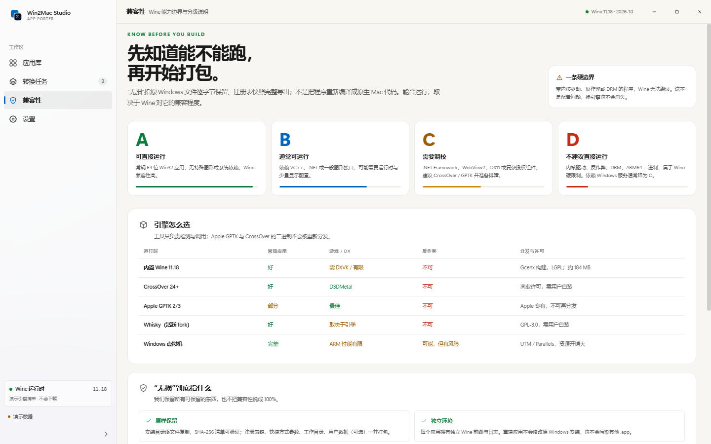 | 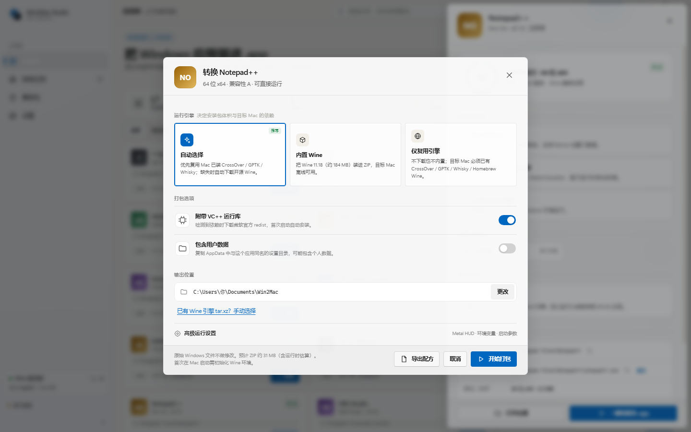 |

| 安装器模式（实验性） | 批量转换 |
|---|---|
| 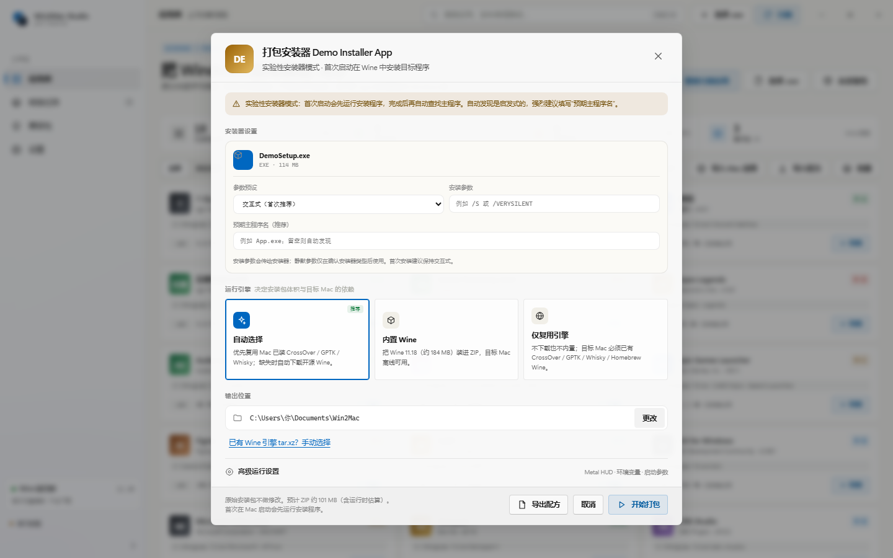 | 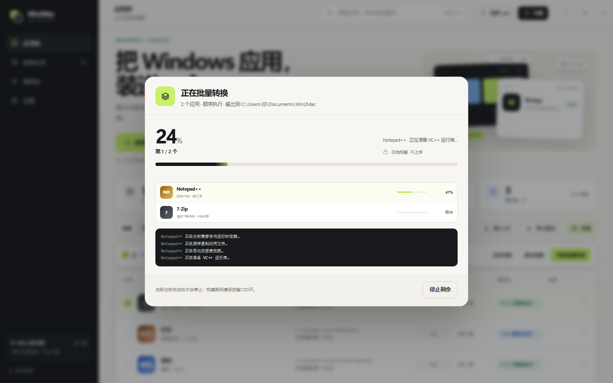 |

| 高级运行设置 | 批量完成 |
|---|---|
| 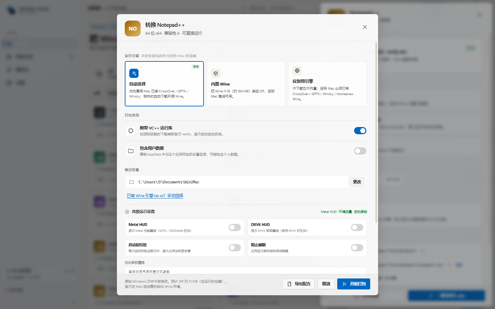 | 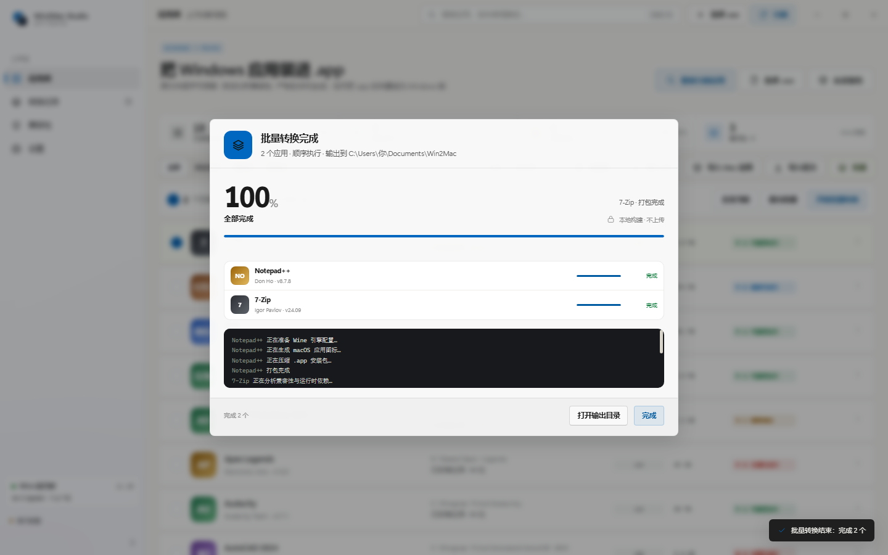 |

| 移植配方 | 缓存与空间 |
|---|---|
| 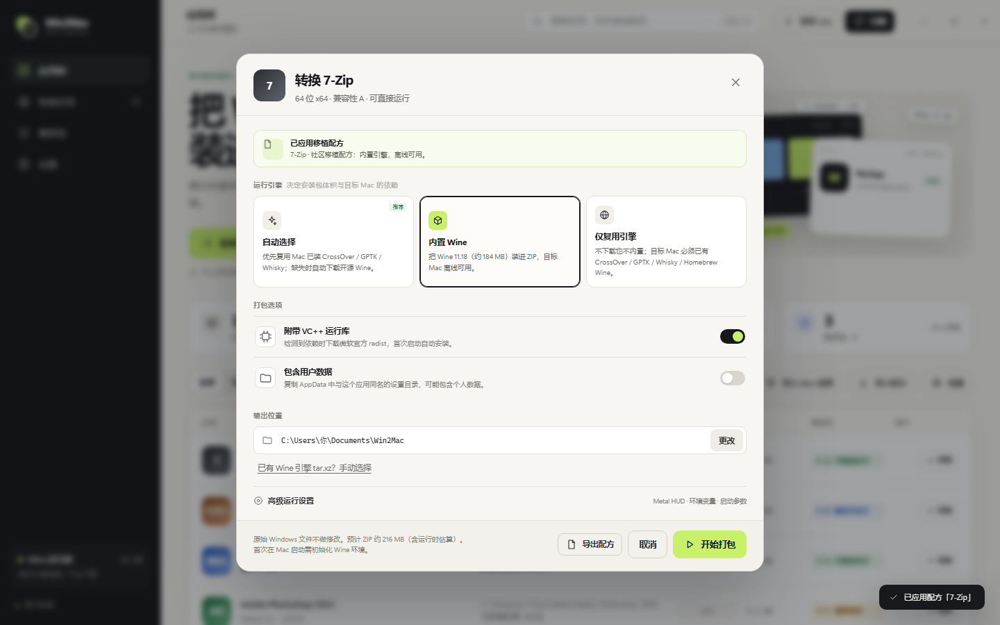 | 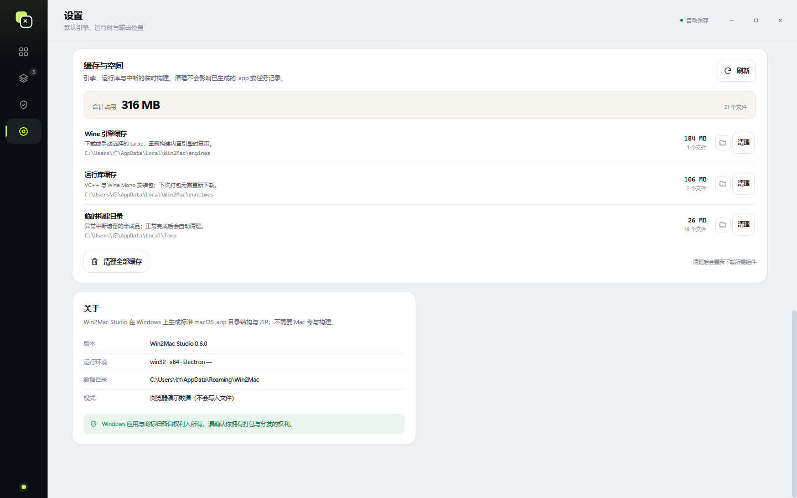 |

| 拖拽导入 |
|---|
| 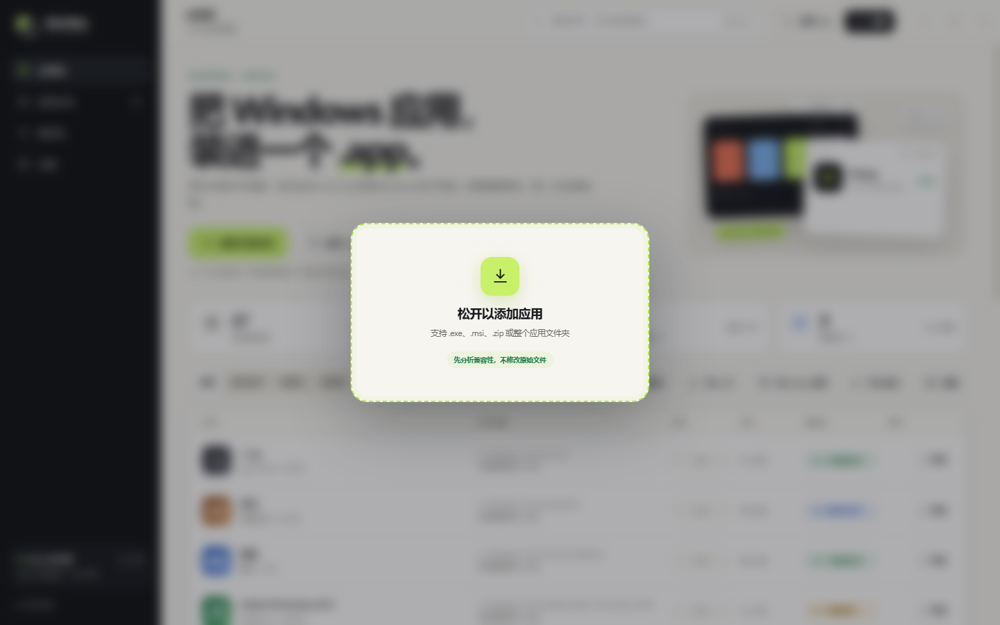 |

## 快速开始

### 最终用户（Windows 10/11 x64）

1. 从 [GitHub Releases](https://github.com/cv-superding/win2mac-studio/releases) 下载并运行 `Win2Mac-Studio-Setup-0.4.1.exe`（未签名，SmartScreen 可能提示“更多信息 → 仍要运行”）。
2. 打开应用，点击“扫描已安装应用”。
3. 点选应用查看分级与原因；确认后点“一键转换为 .app”。也可以在「设置」中改默认引擎，或用“批量”多选后队列转换。
4. 有安装包时点“从安装包创建”，选择 `.exe`/`.msi`，填写预期主程序名（推荐）后打包；首次在 Mac 启动会自动运行安装器。
5. 也可以把已解包的应用目录压缩成 **ZIP**，点工具栏“导入 ZIP”；软件会解压、识别主程序并加入应用库，后续转换和普通应用一样。
6. 选择输出目录，等待生成。把 **ZIP 原样**拷到 Mac，在 macOS 用 Finder 解压，双击 `Open-Win2Mac-App.command`。
7. 首次打开若被 macOS 拦截（未签名应用的正常现象）：打开“系统设置 → 隐私与安全性”点“仍要打开”，或在终端运行 `xattr -dr com.apple.quarantine .`。放行一次后，`Open-Win2Mac-App.command` 会自动清除整个文件夹的隔离标记并修复脚本权限。
8. 如果朋友那边报错，让他双击同目录的 `Start-Mac-Validation.command`；它会启动应用并把完整日志和诊断包放到 Mac 桌面。把 `Win2Mac-诊断-*.zip` 发回即可。

> 也可以把 `.exe`、`.msi` 或应用文件夹直接拖进窗口。拖入文件夹时会自动挑选主程序；文件名像安装器时会询问按“应用”还是“安装程序”处理。

> 不要用 Windows 资源管理器解压 ZIP，否则 `.app` 和 `.command` 会丢失执行权限。README 内附手动 `xattr/chmod` 命令。

### 从源码运行

要求：Windows 10/11、Node.js 22+、PowerShell 5.1、curl（Windows 自带）。

```bat
npm install
npm start
```

如果 Electron 下载慢，可设代理：

```bat
set HTTPS_PROXY=http://127.0.0.1:7897
set ELECTRON_GET_USE_PROXY=1
npm install
```

若启动后只打印 Node 版本，请清除环境变量 `ELECTRON_RUN_AS_NODE` 后重试。

### 打包 Windows 安装程序

```bat
npm run dist
```

输出在 `release/Win2Mac-Studio-Setup-0.4.1.exe`。构建时 electron-builder 需要网络下载 NSIS 工具链；CI/国内网络请配置代理。

## 三种引擎策略

| 策略 | 安装包 | 首次启动 | 适用 |
|---|---|---|---|
| 自动（默认） | 小 | 优先用 Mac 已装 CrossOver/GPTK/Whisky；缺失时下载 Gcenx Wine（约 184 MB） | 大多数用户 |
| 内置 Wine 11.18 | +184 MB | 离线解压即用 | 目标 Mac 网络差/离线演示 |
| 仅复用现有引擎 | 最小 | 必须有 CrossOver / GPTK / Whisky / Homebrew Wine | 已购 CrossOver、游戏玩家 |

GPTK/CrossOver 的二进制不会被复制进安装包；只有 Gcenx Wine 会被内置。Apple Silicon 上 x86_64 Wine 需要 Rosetta 2，启动器会提示安装。

## 产物结构

```
Bandizip-macOS/
├─ Bandizip.app/
│  └─ Contents/
│     ├─ Info.plist
│     ├─ MacOS/launcher                 # 0755
│     ├─ Resources/icon.icns
│     └─ Resources/win2mac/
│        ├─ config.env
│        ├─ bundle.json
│        ├─ manifest.sha256             # 103 个文件逐文件校验
│        ├─ payload/D/Tool/Bandizip/...
│        ├─ registry/1.reg
│        ├─ runtimes/vc_redist.x64.exe  # 可选
│        └─ engine/wine-staging-11.18...tar.xz # 可选
├─ Open-Win2Mac-App.command             # 0755
├─ Verify-Integrity.command             # 0755
├─ Reset-Runtime.command                # 0755
└─ README-使用说明.html
```

启动器把 `payload/C` 合并到 prefix 的 `drive_c`，把其他盘符映射为 `drive_c/win2mac_D` 并建立 `dosdevices/d:`，从而保留原应用的 `D:\...` 路径和注册表值。

## CLI

```bat
node cli.js scan --out scan.json
node cli.js analyze --exe "C:\Program Files\7-Zip\7zFM.exe" --install "C:\Program Files\7-Zip"
node cli.js build --exe "C:\Program Files\7-Zip\7zFM.exe" ^
  --install "C:\Program Files\7-Zip" --name "7-Zip" ^
  --out "%USERPROFILE%\Documents\Win2Mac" --engine auto
node cli.js build --exe "C:\Program Files\7-Zip\7zFM.exe" ^
  --install "C:\Program Files\7-Zip" --recipe "7-Zip.win2mac.json"
node cli.js engines --proxy http://127.0.0.1:7897
```

`--engine bundled --engine-archive path\to\wine.tar.xz` 可离线内置；`--no-runtimes` 跳过 VC++/Mono 下载；`--no-mono` 不附带 Wine Mono；`--user-data` 包含同名 AppData 目录。`--recipe` 应用移植配方，显式 CLI 参数优先于配方。

## 验证

```bat
npm test        :: PE/plist/ICNS/路径/快捷方式防护/服务分级等单元测试
npm run test:e2e :: 打包/首启二启/引擎下载/安装器工作流
```

已实测：

- Windows 11 本机扫描 172 个应用：172 个真实图标、全部完成兼容性评估（101 A/B、55 C、16 D，0 待评估）。
- Bandizip 真应用：103 文件 / 23 MB / 1 注册表键；D: 盘映射后 EXE SHA-256 与源一致。
- ZIP 中文文件名 UTF-8、launcher/`.command` 0755、ZIP 完整性通过。
- 单元测试 39/39：ZIP 解压与恶意路径拒绝、配方格式/越权字段校验、拖拽文件夹主程序挑选、缓存统计与清理范围、Electron/ASAR/原生模块/adb 检测、注册表候选、USB 阻断、ADB 桥接、缺失文件自动诊断、macOS 启动器 Darwin 分支、模板 LF 行尾回归。
- macOS 启动器模拟：假 `uname`/`sw_vers`/`arch` + 假 Wine，在 Windows 上执行真实 `launcher.sh`，验证 ARM Rosetta 分支、macOS 11 版本门槛、首启/二启、环境变量、启动参数、完整性校验、`Open/Verify/Reset/Start-Mac-Validation` 辅助脚本。同一测试在 macOS 原生 bash 下直接运行。
- 安装器模式：首启运行安装器 → 自动发现主程序 → 二次启动不重装；包内 README/配置正确。
- 批量模式：多选、顺序构建、进度/失败信息、完成汇总（离屏 UI 截图验证）。
- 配方：导出 JSON 不含本机绝对路径/脚本/URL；导入后自动匹配 7-Zip 并带入内置引擎、完整性与环境变量（离屏 UI 验证）；CLI `--recipe` 复用同一转换函数。
- 拖拽/ZIP/缓存：文件夹主程序排序（排除 `unins000.exe`/`setup.exe`）、ZIP 顶层目录识别、缓存白名单清理、拖拽遮罩、ZIP 导入与缓存卡片截图验证。
- Mac 验证收集器：模拟运行 `Start-Mac-Validation.command`，确认生成桌面日志与诊断目录（含 `Report.md` / `Report.json` / `Missing.txt` / `Repair.md`、config、manifest、payload-index、系统/引擎/前缀信息），并验证不会复制 payload；缺失/损坏文件会写入 `Missing.txt` 与 `Report.json`。
- 行尾回归：5 个 macOS 脚本模板与打包后的 launcher 均断言为 LF，避免 CRLF 导致 `bad interpreter`。
- 内置引擎：真实 xz 解压、缓存、引擎路径发现与启动；Gcenx Wine 11.18 真实下载、SHA-256 校验、内置包生成（186 MB ZIP）。
- 运行时引擎下载：本地 HTTP 下载 → SHA-256 → 解压 → 启动；第二次启动复用缓存且不重复下载。
- VC++ 运行时：真实下载 + Microsoft Authenticode 校验 + 模拟安装流程；Windows 服务依赖改为 C 级提示，不再误判 D。
- 打包后的 Electron 应用通过无窗口 smoke test（preload 桥接、四个导航页面、版本 0.4.1）；真实 IPC 扫描 UI 也通过离屏 smoke-scan（172 应用 / 172 图标 / 0 分析挂起）。

**macOS CI**：仓库内提供 [`.github/workflows/macos-verify.yml`](.github/workflows/macos-verify.yml)，在 `macos-14`/`macos-15` 上跑 `bash -n`、单元测试与真实 Darwin 启动器模拟。当前工作区不是 GitHub 仓库，尚未触发托管 CI；推送后即可运行。

**验证边界**：当前开发环境是 Windows 11；启动器已通过“假 Darwin + 假 Wine”、真实 tar.xz 解压与脚本级测试，并具备 macOS CI，但**仍未在物理 Mac 上启动过**。正式分发前请按 [macOS 真机验收清单](docs/MACOS-TESTING.md) 在一台 Intel 或 Apple Silicon Mac 上做一次冒烟测试（建议同时验证 CrossOver/GPTK 复用路径与 Gatekeeper 首次放行）。

## 已知限制

- 不生成原生 Mach-O，不做源码重编译；性能与兼容性取决于 Wine。
- 反作弊、内核驱动、DRM、UWP/MSIX、部分 WebView2 不可用；Windows 服务不会运行，依赖服务的应用会降为 C 并提示功能风险。
- **USB/ADB 设备无法直通**：Wine 在 macOS 上不能把 USB 设备交给 Windows 程序，依赖 `adb.exe`、`scrcpy`、`libusb` 的应用（手机投屏、加密狗、串口设备等）会被评为 D；这类需求只能用虚拟机或官方 Mac 版。
- 应用安装在系统盘/整盘根目录、主程序不在安装目录、或工作目录跨目录时会阻止/警告；这类布局可能不完整。
- 32 位应用依赖 Wine WoW64；旧引擎可能失败，建议 CrossOver 24+。
- 未签名、未公证；macOS 15+ 需在“隐私与安全性”中允许，ad-hoc 签名不能替代开发者 ID 公证。安装包本身未签名。
- 媒体应用可能需要 GStreamer（缺失通常只影响音视频播放，不影响启动）；.NET Framework 复杂应用可能需要 winetricks/CrossOver。
- 会导出卸载项、App Paths、常见厂商 HKCU/HKLM 键，并合并 AppData 配置，但无法覆盖所有私有注册表/加密存储；依赖机器码（MachineGuid、磁盘序列号）的授权在 Wine 中可能失效。
- 安装器模式为实验性：目标程序在 Mac 首次启动时才安装，兼容性未知；自动发现主程序是启发式，建议填写预期 EXE 名。交互式安装器需要 Wine 窗口可用。
- 移植配方只保存匹配信息、引擎/运行库/高级选项与安装参数，不包含安装包、注册表、用户数据或任何可执行脚本；导入方仍需自备应用/安装包并自担分发权利。
- 缓存清理是白名单操作：只处理 `%LOCALAPPDATA%\Win2Mac\engines`、`runtimes` 与系统临时目录下的 `win2mac-build-*`；转换进行中会拒绝清理。
- 同一应用重建会复用同一个 Wine 前缀，旧版本残留文件不会自动删除；遇到异常请使用包内 `Reset-Runtime.command` 重置。

## 项目结构

| 路径 | 说明 |
|---|---|
| `engine/` | 扫描、PE/兼容性分析、图标/ICNS、plist、打包、引擎解析、下载、配方、拖拽识别、缓存 |
| `app/` | 无框架渲染层（HTML/CSS/JS）+ 演示数据 |
| `electron/` | 主进程、IPC、窗口与安全边界 |
| `resources/scripts/` | PowerShell 扫描/图标/签名校验 |
| `resources/templates/` | macOS 启动器、修复/校验/一键诊断脚本、中文 README 模板 |
| `cli.js` | 无界面扫描/分析/打包（支持 `--recipe`） |
| `test/` | 单元测试、macOS 启动器模拟、Windows E2E、UI 截图辅助 |
| `.github/workflows/` | macOS 14/15 启动器验证工作流 |
| `tools/make-mac-check.js` | 生成可独立发送的 Mac 验证工具 ZIP |
| `docs/` | 调研、架构、配方格式、macOS 真机验收清单、截图 |

技术细节见 [docs/ARCHITECTURE.md](docs/ARCHITECTURE.md)，调研与许可证结论见 [docs/RESEARCH.md](docs/RESEARCH.md)。

## 许可证

本项目代码采用 MIT。Wine 为 LGPL-2.1+，由 Gcenx 构建；Apple GPTK、CrossOver、Whisky 等归各自权利人，本项目只检测/调用，不再分发。详情见 [NOTICE.md](NOTICE.md)。

Windows 应用、图标与商标归各自发布者所有。请确认你拥有将应用打包与分发的权利；本工具不授予任何再分发权。
